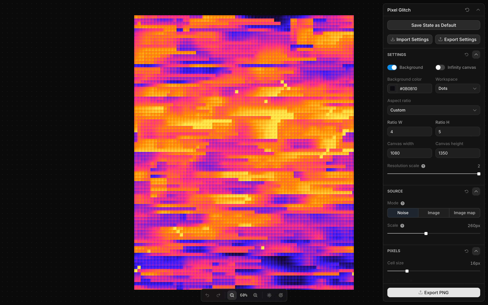
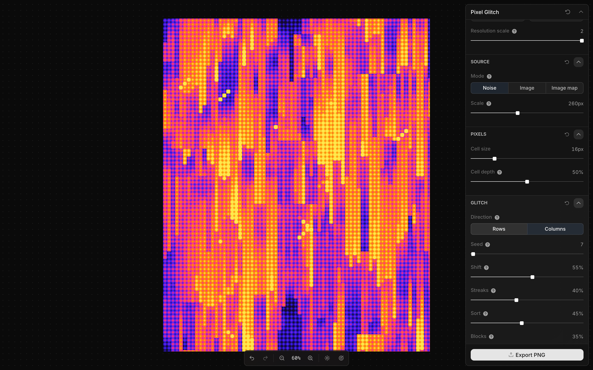

# Pixel Glitch

A browser tool for making pixelated glitch art. It turns a noise field or your own photo into a grid of cells, tears it apart with seeded glitches, and colors it through a gradient whose shape also shades each cell for a sense of depth. Export the result as PNG or JPG.





## What it does

**Source.** Pick one of three modes:

- **Noise** generates a seeded fractal noise field. *Scale* sets the size of its features.
- **Image** uses an uploaded photo (cropped to fill the canvas) and keeps the photo's own colors. Rotate and flip are built in.
- **Image map** uses the photo's brightness and recolors it through the gradient. Each new upload fills the gradient with five colors taken from that photo, dark to light.

**Pixels.** *Cell size* (4–64 px) sets how big each pixel is. *Cell depth* sets how strongly each cell is shaded inside.

**Glitch.** Every effect is seeded, so the same settings always give the same picture.

| Control | Effect |
| --- | --- |
| Direction | Tear along rows or columns |
| Seed | A different arrangement of everything below |
| Shift | Bands slide sideways and jump in brightness |
| Streaks | A cell's value smears along its row or column |
| Sort | Runs of bright cells are pixel-sorted dark to light |
| Blocks | Rectangular chunks are copied from elsewhere |
| Scatter | Loose bright cells, alone or in short diagonal steps |

**Gradient.** The stops recolor cell brightness from dark to light. The gradient's **type** and **angle** also shape the shading inside every cell: linear gives a bevel, radial a pillow, and angular and diamond give their own facets. That in-cell shading is the "gradient variation for depth".

**Output.** PNG or JPG at 2K, 4K or 8K on any canvas size, with an optional transparent background.

## Run it locally

You need Node.js 20.19+ or 22.12+ (developed on Node 26) and npm.

```bash
git clone https://github.com/nashinoki21/pixeland.git
cd pixeland
npm install
npm run dev
```

`npm run dev` prints the local address to open. No accounts, keys or environment variables are needed. Uploaded photos and your settings are kept in the browser's own storage.

## How it's built

Pixel Glitch is a [Toolcraft](NOTICE.md) app: Toolcraft provides the editor shell (canvas, controls panel, toolbar, history, persistence and export), and this project supplies the schema and a Canvas 2D renderer.

| Path | What's there |
| --- | --- |
| `src/app/glitch/glitch-core.ts` | The effect: noise, glitch steps, gradient lookup, in-cell shading |
| `src/app/glitch/glitch-render.ts` | Photo sampling and drawing the grid into a canvas |
| `src/app/glitch/glitch-canvas.tsx` | Live preview, including the photo-palette fill on upload |
| `src/app/glitch/glitch-export.ts` | The same render for PNG/JPG export |
| `src/app/glitch/glitch-controls.ts` | Control sections and defaults |
| `src/app/app-schema.ts`, `app-composition.tsx` | Wiring into Toolcraft |
| `e2e/product-*.spec.ts` | Browser acceptance tests, one file per area |

`src/toolcraft/` is a signed copy of the Toolcraft runtime and must not be edited by hand; see `AGENTS.md` for the project rules.

## Tests

```bash
npm run test
```

Runs the docs and integrity checks, the framework's script tests, and the Vitest contract and product tests.

```bash
npx playwright install chromium
npm run test:feature -- <acceptance-id>
```

Runs the browser test for one acceptance row (ids are in `src/app/app-acceptance-data.ts`). The first full proof, `npm run verify:delivery`, passed: production build plus all 23 browser tests.

## License

The bundled Toolcraft runtime is under the MIT License; see `LICENSE.md` and `NOTICE.md`.
